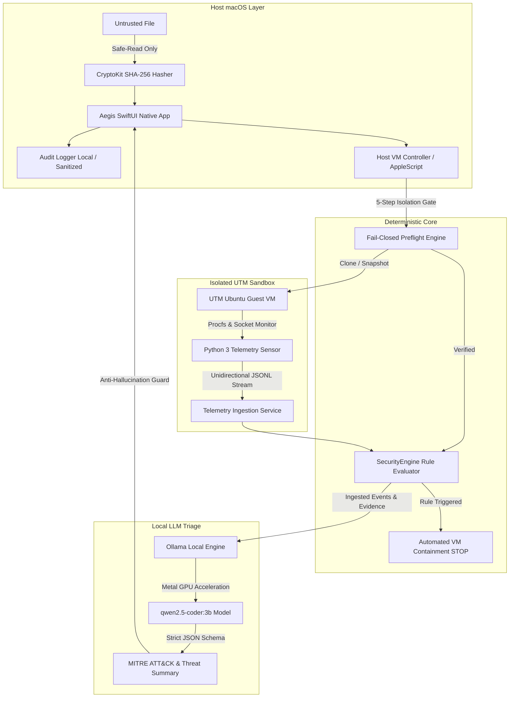

# 🛡️ Aegis – Autonomous macOS Sandbox Defense & Behavioral Security Engine


**Aegis** is an advanced, native macOS cybersecurity application engineered for Apple Silicon to analyze suspicious files, software downloads, and untrusted workloads inside an isolated, disposable virtual sandbox. It unifies **Deterministic Security Rules**, **Preflight Isolation Enforcement**, **Ephemeral Guest Telemetry Ingestion**, **Automated Host Containment**, and **Local On-Device LLM Reasoning (`qwen2.5-coder:3b` via Ollama)**.

Designed around a strict **Fail-Closed** security posture, Aegis eliminates zero-day host breakout risks through cryptographic safe-reading (CryptoKit SHA-256), complete network and hardware isolation (no shared host folders, no shared clipboard, no USB passthrough), and append-only sanitized audit logging with instantaneous bilingual support (English and Italian).

---

## 📑 Table of Contents
- [🏛️ System Architecture](#-system-architecture)
- [🌟 Key Features](#-key-features)
  - [1. Deterministic Rule Engine & Zero False Positives](#1-deterministic-rule-engine--zero-false-positives)
  - [2. Ephemeral Guest Runtime & Zero-Leakage Telemetry](#2-ephemeral-guest-runtime--zero-leakage-telemetry)
  - [3. Local On-Device LLM Triage & MITRE ATT&CK Mapping](#3-local-on-device-llm-triage--mitre-attck-mapping)
  - [4. Strict Fail-Closed Preflight & Hardware Hardening](#4-strict-fail-closed-preflight--hardware-hardening)
  - [5. Native Reactive Bilingual UI (English & Italian)](#5-native-reactive-bilingual-ui-english--italian)
  - [6. Standalone Packaging (.app, .dmg, .zip)](#6-standalone-packaging-app-dmg-zip)
- [🔒 Non-Negotiable Security Principles](#-non-negotiable-security-principles)
- [💻 System Requirements](#-system-requirements)
- [🚀 Quick Start Guide](#-quick-start-guide)
- [🛡️ Deterministic Rule Catalog](#-deterministic-rule-catalog)
- [🧪 Test Suite & CI Verification](#-test-suite--ci-verification)
- [📁 Directory Structure](#-directory-structure)
- [🗺️ Release Milestones & Roadmap](#-release-milestones--roadmap)
- [⚠️ Security, Privacy & Legal Disclaimer](#-security-privacy--legal-disclaimer)

---

## 🏛️ System Architecture



---

## 🌟 Key Features

### 1. Deterministic Rule Engine & Zero False Positives
- **Deterministic Independence**: Evaluates behavioral events strictly against deterministic security rules without relying on cloud APIs or machine learning heuristics.
- **Evidence Cross-Linking**: Every detected anomaly links back directly to the immutable telemetry event ID, timestamp, and raw process descriptor that triggered it.
- **Clean Baseline Compliance**: Normal operational software lifecycles are validated and deterministically classified as `Undetected` without spurious alerts.

### 2. Ephemeral Guest Runtime & Zero-Leakage Telemetry
- **Standard Library Guest Agent**: Lightweight Python 3 telemetry monitor running inside Ubuntu ARM64 guest with zero third-party dependencies.
- **Continuous Behavior Tracking**: Intercepts process spawns (`/proc`), rapid file bursts in `/tmp`, and unauthorized egress network socket attempts (`/proc/net/tcp`).
- **Heartbeat Fail-Closed Guard**: Emits a periodic monotonic heartbeat; if the telemetry channel is degraded or silenced by malware, the engine transitions to degraded mode and pauses analysis.

### 3. Local On-Device LLM Triage & MITRE ATT&CK Mapping
- **100% On-Device Privacy**: Local reasoning via quantized LLMs (e.g., `qwen2.5-coder:3b` via Ollama) executing on Apple Silicon GPU via Metal. No file names, hashes, or logs leave the Mac.
- **Strict JSON Schema Enforcement**: LLM output is parsed against rigid Swift Codable schemas containing executive summaries, MITRE ATT&CK techniques (e.g., `T1071.001`, `T1059.004`), risk scores, and whitelisted actions (`STOP_VM`, `CONTINUE_MONITORING`).
- **Anti-Hallucination Evidence Filter**: Cross-checks all cited telemetry IDs against real ingested events, immediately discarding fabricated or hallucinated IDs.

### 4. Strict Fail-Closed Preflight & Hardware Hardening
- **5-Step Mandatory Isolation Wizard**: Requires deterministic verification of all 5 isolation criteria before any analysis can begin:
  1. Virtual Machine network interface physically disconnected.
  2. Host shared folders and WebDAV/VirtFS shares disabled.
  3. Shared clipboard and drag-and-drop disabled.
  4. USB device passthrough prohibited.
  5. Clean snapshot state verified (`clean-baseline`).
- **Zero False Readiness**: The system never marks an environment as "Protected" or ready simply because UTM is installed.

### 5. Native Reactive Bilingual UI (English & Italian)
- **Runtime Language Switching**: Full support for both English (🇬🇧) and Italian (🇮🇹) with instant dynamic UI refresh across all tabs, warnings, and settings.
- **First-Launch Onboarding**: Prompts user for preferred default language during initial setup and stores preferences in persistent configuration.

### 6. Standalone Packaging (.app, .dmg, .zip)
- **One-Command Distribution**: Automated build script compiles release binaries, bundles metadata, applies ad-hoc code signatures, and creates ready-to-distribute DMG disk images and ZIP archives.

---

## 🔒 Non-Negotiable Security Principles

1. **Safety Operates Without LLM:** Deterministic containment executes autonomously. The defense engine functions reliably even if the LLM is unavailable, slow, or manipulated.
2. **Zero Shell Privileges for the LLM:** The LLM is an analytical spectator with read-only access to passive logs; it never executes shell commands or controls sockets.
3. **Maximum Default Isolation:** No network, no shared folders, no clipboard sharing, and no USB passthrough.
4. **No Implicit Host Execution:** Target files are inspected cryptographically on the host via in-memory safe reads. No sample code is ever executed on the macOS host.
5. **Zero Real Malware in Repository:** Repository code, unit tests, and CI workflows use exclusively synthetic benign fixtures and controlled simulations.
6. **Fail-Closed Policy:** Any unverified prerequisite or ambiguous isolation state immediately halts analysis.

---

## 💻 System Requirements

- **Platform:** macOS 14 (Sonoma) or newer on **Apple Silicon** (M1 / M2 / M3 / M4 / M5).
- **Toolchain:** Swift 6.0+ or Xcode 16.0+.
- **Virtualization Engine:** [UTM Virtual Machines for macOS](https://mac.getutm.app/) (Free / Open-Source).
- **Local LLM Engine (Optional):** [Ollama](https://ollama.com/) with model `qwen2.5-coder:3b`.
  ```bash
  # Install Ollama via Homebrew
  brew install ollama
  brew services start ollama

  # Pull the lightweight model optimized for 8GB / 16GB Apple Silicon
  ollama pull qwen2.5-coder:3b
  ```

---

## 🚀 Quick Start Guide

### 1. Clone & Build
```bash
# Clone the repository
git clone https://github.com/gabrielemolino/Aegis.git
cd Aegis

# Build in debug mode
swift build
```

### 2. Run Test Suite
```bash
# Execute complete Swift unit, integration, and E2E test suite (50 tests)
swift test

# Execute Python guest telemetry sensor tests (6 tests)
python3 guest-sensor/test_sensor.py
```

### 3. Launch Application
```bash
# Launch the native SwiftUI application
swift run SentinelAI
```

### 4. Package Standalone Distribution
```bash
# Generate Aegis.app bundle, ZIP archive, and DMG disk image in dist/
chmod +x scripts/package_macos.sh
./scripts/package_macos.sh
```

---

## 🛡️ Deterministic Rule Catalog

| Rule ID | Category | Severity | Description | Action |
| :--- | :--- | :---: | :--- | :--- |
| `RULE-HEARTBEAT-000` | Sensor Integrity | Medium | Guest telemetry heartbeat missed or timed out. | Degrade state to Fail-Closed |
| `RULE-NET-003` | Network Egress | Critical | Outbound network connection attempt on isolated VM. | Immediate VM Shutdown |
| `RULE-PERSIST-002` | System Persistence | Critical | Unauthorized modification of `/etc/cron*` or system services. | Immediate VM Shutdown |
| `RULE-PROC-005` | Process Execution | High | Suspicious child process or unexpected interpreter spawned. | Alert & Evidence Link |
| `RULE-IO-014` | Filesystem I/O | Medium | Burst creation of temporary executable artifacts in `/tmp`. | Flag Suspicious State |
| `RULE-INJECT-001` | Anti-Tampering | Low | Hostile prompt injection attempt detected in log stream. | Sanitize & Treat as Passive |

---

## 🧪 Test Suite & CI Verification

Aegis enforces a comprehensive local and GitHub Actions test suite running on `macos-14` Apple Silicon runners:

| Test Suite | Tests | Status | Execution Time |
| :--- | :---: | :---: | :---: |
| **SystemCheckService Tests** | 4 | ✅ Passed | ~0.006s |
| **SentinelAI Baseline Tests** | 4 | ✅ Passed | ~0.006s |
| **AuditLogger Tests** | 3 | ✅ Passed | ~0.007s |
| **Deterministic Rule Engine Tests (v0.3)** | 8 | ✅ Passed | ~0.009s |
| **VM Host Controller Tests (v0.4)** | 6 | ✅ Passed | ~0.018s |
| **Guest Telemetry Ingestion Tests (v0.5)** | 5 | ✅ Passed | ~0.022s |
| **Local LLM & Schema Validation Tests (v0.6)** | 7 | ✅ Passed | ~0.023s |
| **Aegis End-to-End & Localization Tests (v0.7)** | 3 | ✅ Passed | ~0.025s |
| **Report & Classification Tests** | 3 | ✅ Passed | ~0.026s |
| **UTM Management & Hardening Tests (v0.2)** | 7 | ✅ Passed | ~0.250s |
| **Guest Python Sensor Unit Tests** | 6 | ✅ Passed | ~2.550s |
| **Total Test Coverage** | **56 / 56** | **100% Green** | **< 3.0s** |

---

## 📁 Directory Structure

```text
Aegis/
├── .github/
│   ├── workflows/ci.yml           # GitHub Actions CI workflow (macOS-14, Xcode 16)
│   └── ISSUE_TEMPLATE/            # Bug report, feature request & security configuration
├── Sources/SentinelAI/            # Native macOS Application Sources (Swift 6 & SwiftUI)
│   ├── App/                       # Entry point, AppState, and application lifecycle
│   ├── Models/                    # Telemetry event schemas, analysis reports & MITRE models
│   ├── Services/
│   │   ├── LocalizationManager.swift # Reactive bilingual manager (English & Italian)
│   │   ├── SecurityEngine.swift   # Deterministic detection rules & containment engine
│   │   ├── VMHostController.swift # UTM AppleScript controller & watchdog probe
│   │   ├── LocalLLMService.swift  # Local LLM integration (Ollama qwen2.5-coder:3b)
│   │   ├── TelemetryIngestionService.swift # Safe JSONL stream parser & validator
│   │   ├── SystemCheckService.swift # Host environment & architecture sanity checks
│   │   └── AuditLogger.swift      # Sanitized immutable log exporter (JSON / text)
│   └── Views/                     # Native SwiftUI reactive interface
│       ├── Navigation/SidebarView.swift
│       └── Screens/               # Overview, UTM Manager, Rule Workbench, LLM, Settings
├── Tests/SentinelAITests/         # 50 Swift Unit, Integration & End-to-End Tests
├── guest-sensor/                  # Python 3 telemetry agent for Ubuntu ARM64 Guest
│   ├── sentinel_guest_sensor.py   # Process spawn, burst I/O & egress network monitor
│   └── test_sensor.py             # 6 Telemetry validation unit tests
├── scripts/
│   └── package_macos.sh           # Standalone packaging script (.app, .dmg, .zip)
├── CONTRIBUTING.md                # Contribution guidelines & zero-malware policy
├── DISCLAIMER.md                  # Comprehensive bilingual legal disclaimer
├── ROADMAP.md                     # Project architecture & milestone roadmap
├── SECURITY.md                    # Security policy, responsible disclosure & disclaimer
├── THREAT_MODEL.md                # Formal STRIDE threat model & isolation boundaries
├── LICENSE                        # MIT License
└── Package.swift                  # Swift Package Manager manifest (Swift 6.0+)
```

---

## 🗺️ Release Milestones & Roadmap

For full milestone details and future development horizons (eBPF probes, automated memory diffing, Yara scanning), please consult [ROADMAP.md](ROADMAP.md).

| Version | Milestone Goal | Status |
| :--- | :--- | :---: |
| **v0.1** | Native SwiftUI UI, safe-read CryptoKit SHA-256, preflight fail-closed checks, audit log. | **Completed** |
| **v0.2** | Guided 5-step UTM hardening wizard, watchdog query timeout, rollback policy enforcement. | **Completed** |
| **v0.3** | Deterministic rule engine with versioned catalog, 6 synthetic datasets, interactive Rule Workbench. | **Completed** |
| **v0.4** | Host VM controller with authorized whitelist, zero false shutdowns, post-containment rollback enforcement. | **Completed** |
| **v0.5** | Python 3 guest telemetry sensor, unidirectional JSONL ingestion, non-simulated real analysis engine. | **Completed** |
| **v0.6** | Local Ollama LLM (`qwen2.5-coder:3b`), semantic triage, MITRE ATT&CK mapping, rigid JSON validation. | **Completed** |
| **v0.7** | Rebranding to **Aegis**, reactive bilingual UI (EN/IT), limitation of liability, 56 tests, macOS packaging. | **Completed** |

---

## ⚠️ Security, Privacy & Legal Disclaimer

> **The author and developers of Aegis expressly disclaim any and all liability and responsibility for any use made of this software, or for any direct, indirect, incidental, special, or consequential damages, loss of data, system malfunctions, or security incidents arising from analyzing, handling, or interacting with potentially malicious, unknown, or hazardous files.**  
> The user assumes sole and exclusive responsibility for their actions, for ensuring the strict isolation of their hardware and network infrastructure, and for compliance with all applicable cybersecurity and computer fraud laws. This software is provided strictly **"AS IS"** for educational, defensive research, security auditing, and controlled sandbox experimentation purposes.

For complete legal terms in English and Italian, please review [DISCLAIMER.md](DISCLAIMER.md).  
For vulnerability reporting procedures, see [SECURITY.md](SECURITY.md).  
For contribution guidelines, see [CONTRIBUTING.md](CONTRIBUTING.md).

---

## 📄 License

Released under the [MIT License](LICENSE).  
Copyright (c) 2026 Aegis Contributors.
